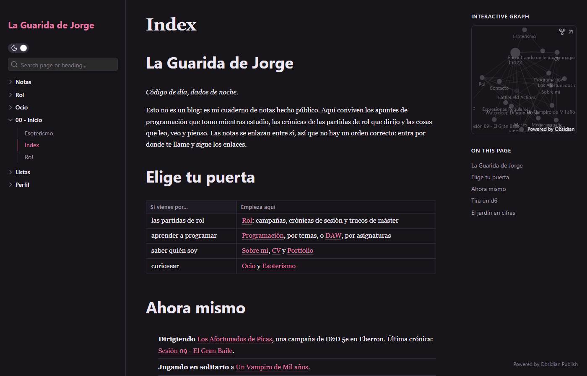
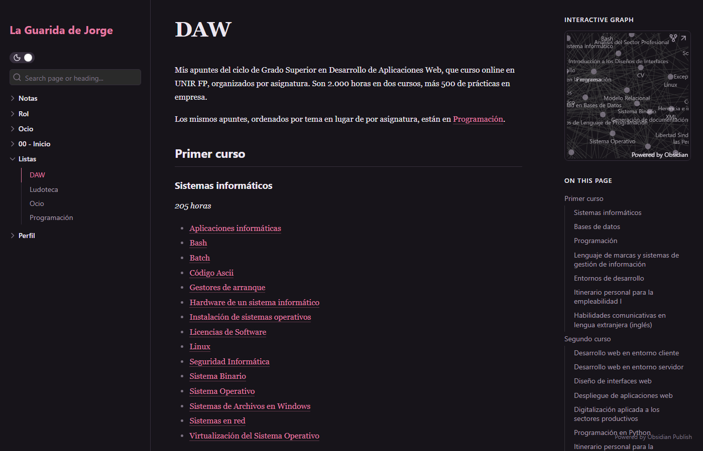
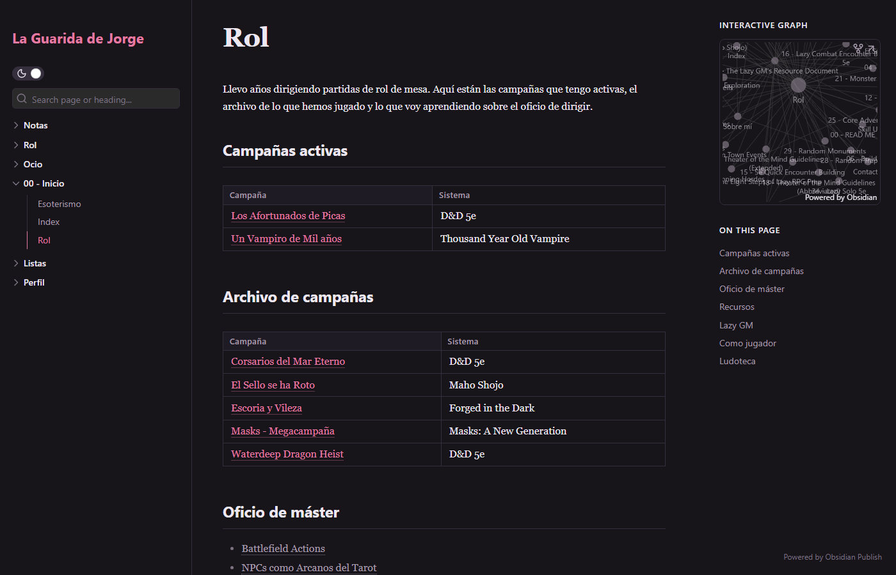

# Cámara General: cómo está montada mi vault de Obsidian

Cámara General es mi vault de Obsidian: apuntes del ciclo de DAW, campañas de rol que dirijo, fichas de ocio y mi perfil profesional. Una parte se publica con Obsidian Publish como jardín digital, **[La Guarida de Jorge](https://publish.obsidian.md/laguaridadejorge)**.

Este repositorio no es la vault. Es la parte reutilizable: estilos, plantillas, bases y scripts. Las notas, las campañas y las fichas de jugadores se quedan fuera.

| Apuntes del DAW por asignatura | Campañas de rol |
|---|---|
|  |  |

## Qué hay aquí

| Ruta | Qué es |
|---|---|
| `publish.css` | Estilos propios de la web publicada |
| `.obsidian/snippets/vault.css` | Estilos dentro de Obsidian sobre el tema Minimal: paleta, encabezados y carpetas en color |
| `Sistema/Plantillas/` | 27 plantillas de Templater: estudio, proyectos, ocio y rol (campaña, sesión, PNJ, lugar, facción…) |
| `.obsidian/plugins/quickadd/data.json` | Comandos de QuickAdd que lanzan esas plantillas (solo `choices` y `macros`, sin ajustes ni claves) |
| `Listas/Bases/` | Vistas de Obsidian Bases: estudio por módulo, ludoteca, ocio, proyectos, rol y seguimiento |
| `Sistema/Scripts/copia-vault.ps1` | Copia de seguridad de la vault en Git a demanda |
| `Sistema/Guía de la Vault.md` | Convenciones: carpetas, propiedades, tags, estilo y qué se publica |
| `.obsidian/community-plugins.json` | Plugins de la comunidad que uso |

## Ideas que lo sostienen

- **Una propiedad `tipo` obligatoria** en cada nota. Bases, CSS y plantillas cuelgan de ella.
- **Plantillas por carpeta**: Templater aplica la plantilla de cada carpeta al crear la nota; la de estudio pregunta ámbito, módulo y origen.
- **Publicar por exclusión**: Publish excluye carpetas enteras (Sistema, Personal, cada `Máster/`). Lo que Publish no ejecuta (Dataview, Bases) va en callouts que la web oculta.
- **Sin servidor**: sincronización con Syncthing entre PC, iPhone e iPad; copia en Git desde el PC.

## Uso

Copia las carpetas en una vault vacía e instala Templater, QuickAdd y los plugins de `community-plugins.json`. Las rutas de las plantillas suponen la estructura de carpetas descrita en la guía; habrá que ajustarlas a la tuya.

## Límites

Es mi sistema personal, no una plantilla pulida. Las plantillas de rol asumen mis campañas y los textos están en español.
